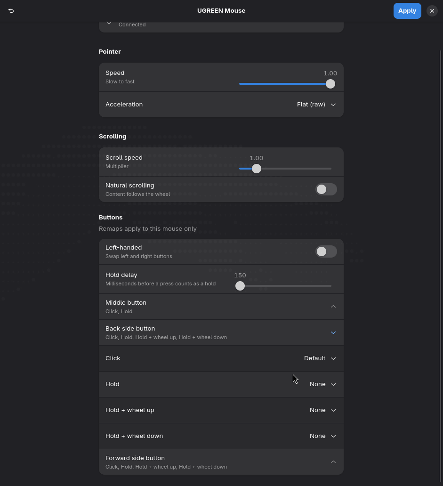

# UGREEN Mouse settings for Hyprland

A small GTK4/libadwaita app that configures a UGREEN 2.4 GHz wireless mouse on
[Hyprland](https://hypr.land) (Lua config, 0.56+): pointer speed, acceleration,
scroll speed, natural scrolling, left-handed mode, and remaps for the middle and
side buttons. Every setting applies **to this mouse only**: other mice and the
touchpad are untouched.



Built for receiver `2b89:0043` ("UGREEN Receiver"). UGREEN's own KM Center app can't
change on-mouse settings for this receiver (see [Protocol notes](#protocol-notes)), so
like KM Center, this app does everything on the computer side.

## Features

- Pointer speed (-1 … 1) and acceleration profile (adaptive / flat)
- Scroll speed multiplier and natural scrolling
- Left-handed button swap
- Separate **click** and **hold** actions for the middle and side buttons, plus
  **hold + wheel up / down** for the side buttons (e.g. hold back and scroll to change
  volume). The hold delay is adjustable.
- Actions: copy, paste, previous / next workspace, close window, volume down / up, mute,
  screenshot, or any custom command. Copy and paste also work in terminals. A button
  with a hold or wheel action still does its normal click (back / forward / middle)
  when tapped.

While a side button is held, the wheel acts at most once every 300 ms (Hyprland's
`binds:scroll_event_delay`). Normal scrolling is never captured.

The volume and screenshot presets call [Omarchy](https://omarchy.org) helpers
(`omarchy-audio-output-volume`, `omarchy-capture-screenshot`). On other setups, use
"Custom command…" instead.

## Requirements

- Hyprland 0.56+ with a Lua config (`hyprland.lua`); uses `hl.device` and device-filtered `hl.bind`
- Python 3, PyGObject, GTK 4, libadwaita (Arch: `python-gobject gtk4 libadwaita`)

## Install

```bash
git clone https://github.com/School-User/ugreen-mouse-hyprland
cd ugreen-mouse-hyprland
install -Dm755 ugreen-mouse-settings.py ~/.local/bin/ugreen-mouse-settings
install -Dm644 ugreen-mouse.desktop ~/.local/share/applications/ugreen-mouse.desktop
```

Load the generated module from `~/.config/hypr/hyprland.lua`, after your own bindings:

```lua
require("hypr.ugreen_mouse")
```

Then create it once (this writes the defaults and reloads Hyprland):

```bash
ugreen-mouse-settings --apply
```

## Usage

Open **UGREEN Mouse** from your launcher, change settings, and press **Apply**.
The ↺ button restores Hyprland's defaults.

| File | Purpose |
|---|---|
| `~/.config/ugreen-mouse/settings.json` | your saved settings |
| `~/.config/hypr/ugreen_mouse.lua` | generated Hyprland config, overwritten on Apply |

`ugreen-mouse-settings --selftest` checks config generation without touching anything.

If your receiver shows up under a different name, change `DEVICE` at the top of the
script to the name from `hyprctl devices`.

## Protocol notes

Findings from reverse engineering, shared for anyone who wants to add on-mouse
(firmware) settings.

**Receiver `2b89:0043`.** It has three HID interfaces: a boot keyboard, a mouse (report 2,
8 buttons, 12-bit X/Y, wheel, AC Pan), and consumer/system controls. Interface 1 also
carries a vendor collection: usage page `0xFFB5`, report ID `0xB5`, 7-byte input and
7-byte output reports, no feature reports.

**UGREEN KM Center 1.0.0** (macOS and Windows) recognises this receiver by VID/PID and
by the SHA-256 of its HID report descriptors. It handles it only as a "general device"
and does remapping on the computer side. KM Center's on-mouse protocol exists only for
the **M520** (receiver `2b89:0900`, plus BLE), even though that receiver's report
descriptors are byte-identical to the `0043` ones. The M520 protocol:

```
B5 33 <81 = read | 03 = write> <cmd> <arg0> <arg1> 00 00      (output report 0xB5)
```

| cmd | dir | meaning |
|---|---|---|
| `A1` | read | serial number / colour |
| `B0` | read | battery (also sent unsolicited) |
| `B1` | n/a | connection status (unsolicited) |
| `B5` | write | custom-button mask, `arg0 = ~mask` (resent every 0.9 s) |
| `B6` | n/a | custom-button press (unsolicited) |
| `E0` | write | set DPI of a level: `arg0` = level 0–4, `arg1` = DPI / 100 |
| `E2` | write | switch active DPI level: `arg0` = level 0–4 |
| `E3` | read | current DPI level and value (also used as an "is the mouse online" probe) |
| `E5` | write | factory DPI reset: 800 / 1200 / 2000 / 3200 / 4000, level 1 active |

KM Center only accepts replies that are 8 bytes long and start with `B5 33`.

**The `0043` receiver does not answer `B5 33 …`.** It uses tag `0x67` instead: when the
mouse wakes, it sends `B5 67` followed by a fixed 5-byte value (looks like the radio
pairing address) and a zero byte. It sends that same frame in reply to any `B5 67 81 …`
packet, whatever the command byte is. The command layout of the `0x67` protocol is still
unknown. If you work it out, a PR is welcome.

## Disclaimer

Not affiliated with or endorsed by UGREEN. "UGREEN" is a trademark of its owner. The
protocol notes come from interoperability analysis; no UGREEN code or binaries are
included. Sending vendor commands to your hardware is at your own risk.

## License

MIT
